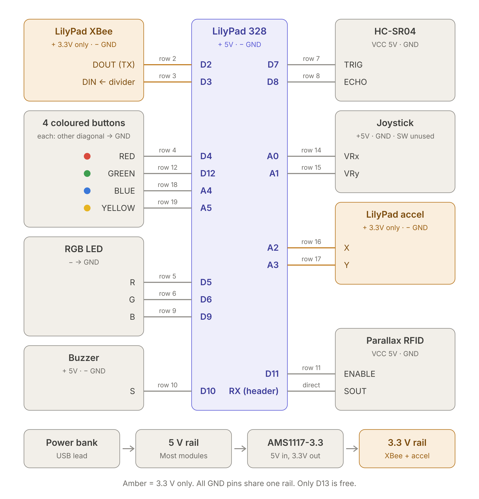

# Simon Says Showdown

Wireless two-player Simon Says game. LilyPad Arduino pods with a joystick, four coloured buttons, RFID, ultrasonic and tilt sensors report to a Java game over XBee. It has voice instructions, a Classic and a Showdown mode, and memory rounds.

COE421L Computer Systems Engineering Lab, American University of Sharjah. Section 01, Group 4.

## How it plays

Simon (the laptop) speaks an instruction and shows it on the big screen. Each player answers on their own pod, and the pod reports what they did and how fast.

| Sensor | What Simon can ask for |
| --- | --- |
| Joystick | Push up / down / left / right |
| Four coloured buttons | Press red / green / blue / yellow, once or twice |
| RFID reader | Scan your card |
| Ultrasonic sensor | Hold your hand low / in the middle / high |
| Tilt controller | Tilt left / right / forward / back |

If an instruction doesn't start with "Simon says", the right answer is to do nothing.

- **Classic** (1 player): 3 lives, one point per correct answer, top 10 leaderboard.
- **Showdown** (2 players): same instruction for both. Fastest correct answer +3, slower correct answer +1, wrong answer −2. First to 21 wins.
- **Memory rounds** every 5th round: Simon reads a sequence of 2 to 5 actions, and you repeat it from memory.
- Time limits shrink and trick instructions become more common every 5 rounds.

## Hardware (per pod)

LilyPad Arduino 328 · LilyPad XBee · 4 tactile buttons · RGB LED · passive buzzer · HC-SR04 · joystick · LilyPad accelerometer (ADXL335) · Parallax 125 kHz serial RFID reader · AMS1117-3.3 regulator · USB power bank.

The laptop uses a third XBee on an XBee Explorer USB.



| Pin | Connects to | Pin | Connects to |
| --- | --- | --- | --- |
| RX | RFID SOUT | D10 | Buzzer |
| D2 | XBee DOUT | D11 | RFID ENABLE |
| D3 | XBee DIN (10k/20k divider) | D12 | Green button |
| D4 | Red button | A0, A1 | Joystick X, Y |
| D5, D6, D9 | RGB red, green, blue | A2, A3 | Accelerometer X, Y |
| D7, D8 | HC-SR04 TRIG, ECHO | A4, A5 | Blue, yellow buttons |

The XBee and accelerometer run on the 3.3 V rail; everything else runs on 5 V.

## Software design

The laptop program is plain Java, built around the **Observer** pattern, used twice:

- **Pods → game.** `XBeeLink` (or `SimulatedPods` for keyboard play) is the subject. Its reader thread turns each radio frame into a `PodMessage` and notifies its observers: the `GameController` and the `HeartbeatMonitor`.
- **Game → outputs.** `GameController` is the subject. Every change (new instruction, result, scores) is sent as a `GameUpdate` to its observers: the console display, the game window and the voice.

The game modes use the **Strategy** pattern: `GameController` holds a `ScoringStrategy`, either `ClassicScoring` or `ShowdownScoring`. Radio, heartbeat, game and window each run on their own thread; shared data is guarded with `synchronized`.

## Repository layout

```text
firmware/pod/        sketch both pods run (only the POD constant differs)
firmware/tests/      one test sketch per module (t1 to t8)
java/src/            the game (one class per file)
java/test/           console test drivers (RunAllTests)
java/lib/            jSerialComm, for the USB serial port
java/sounds/         clip list and scripts that generate the voice clips
docs/                wiring diagram
```

## Getting started

### 1. Flash the pods

Open `firmware/pod/pod.ino` in the Arduino IDE. Pick Board **LilyPad Arduino** and Processor **ATmega328P**, then upload with an FTDI Basic. Set `POD` to `"P1"` or `"P2"` first.

**Unplug the RFID SOUT wire before every upload.** It shares the RX line with the FTDI.

New hardware? Run the module tests in `firmware/tests/` first. Each sketch's header says what a pass looks like.

### 2. Configure the XBees (XCTU)

All three radios use AT mode, PAN ID `4210` and 9600 baud.

| Radio | Role | DH / DL |
| --- | --- | --- |
| Laptop | Coordinator | 0 / FFFF |
| Pod 1 | Router | 0 / 0 |
| Pod 2 | Router | 0 / 0 |

### 3. Make the voice clips

See [`java/sounds/README.md`](java/sounds/README.md).

### 4. Build and run the game

Requires a JDK, version 11 or newer. The only library, jSerialComm, is already in `java/lib/` (see [`java/lib/README.md`](java/lib/README.md)).

Run every command from the `java/` folder, so the game finds `sounds/` and `leaderboard.txt`:

```bash
cd java
javac -cp lib/jSerialComm-2.10.4.jar -d bin src/*.java
javac -cp bin -d bin test/*.java
java -cp bin RunAllTests                                     # tests

java -cp bin:lib/jSerialComm-2.10.4.jar Main --sim           # simulator, no pods needed
java -cp bin:lib/jSerialComm-2.10.4.jar Main --sim --nogui   # simulator, console only
java -cp bin:lib/jSerialComm-2.10.4.jar Main --port COM5     # with the laptop XBee
```

On Windows, use `;` instead of `:` in `-cp`.

If `java` stops with `UnsupportedClassVersionError`, the classes in `bin/` were compiled by a newer JDK than the one running them (Eclipse, for example, may use its own newer JDK). Run the two `javac` lines again with the same JDK as `java`.

#### Playing with the simulator

With `--sim`, both pods are played from the laptop. In the game window, press keys (keep the focus off the name fields; Enter in a name field or a click on a button gives it back):

| Action | Player 1 | Player 2 |
| --- | --- | --- |
| Joystick up / left / down / right | `W` `A` `S` `D` | `I` `J` `K` `L` |
| Press red / green / blue / yellow | `1` `2` `3` `4` | `7` `8` `9` `0` |
| Press a colour twice | Shift + `1`–`4` | Shift + `7`–`0` |
| Hand low / middle / high | `Z` `X` `C` | `N` `M` `,` |
| Tilt left / right / forward / back | `Q` `E` `R` `F` | `U` `O` `P` `;` |
| Scan card (joins in the lobby) | `T` | `Y` |

Shift + number assumes a US keyboard layout. In the console (also with `--nogui`), type the same actions as commands, for example `p1 joy up`, `p2 btn red 2`, `p1 tag`; `p1 off` and `p1 on` unplug and reconnect a pod. Type `help` for the full list.

In Eclipse, use File > Import > Existing Projects into Workspace and pick the `java/` folder. Its project file already sets `src` and `test` as source folders and adds the jar, and `Main` runs from `java/`, so `sounds/` and `leaderboard.txt` are found. Eclipse writes its classes to `java/bin`, the same folder as the commands above.

## Message protocol

Plain-text frames over XBee, for example:

```text
laptop → pods:   <ALL,GO,4000>   <ALL,SEQ,3,6000>   <P1,FB,G>
pods → laptop:   <P1,ACT,TILT,L,1240>   <P2,ACT,BTN,RED_2,610>   <P1,TIMEOUT>   <P1,HB>
```

Pods report what the player did and how many milliseconds after `GO` it happened. All judging and scoring happens in Java.

## Team

| Member | Area |
| --- | --- |
| Omar Matar | Pod hardware and embedded code |
| Ahmed Ahmed | ZigBee communication and RFID |
| Daniel Zakhari | Java game logic |
| Abdulla Shahin | GUI, sound, leaderboard and pod feedback |
